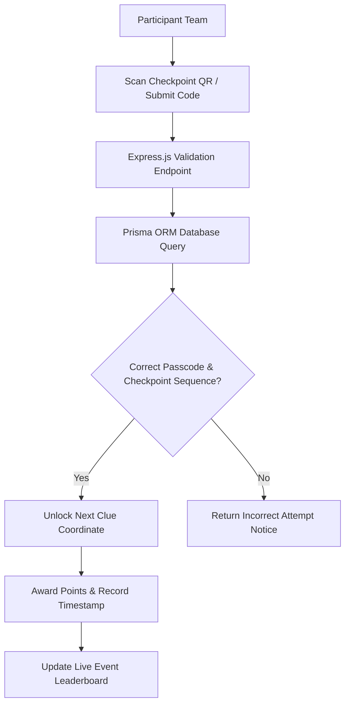

# IEDC Tech Treasure Hunt Platform

<div align="center">

[](https://developer.mozilla.org)
[](https://expressjs.com)
[](https://prisma.io)
[](LICENSE)

</div>

A full-stack campus treasure hunt platform developed for IEDC technical festivals. Features progressive clue unlocking, QR validation, real-time leaderboards, and administrative controls.

---

## Gameplay & Clue Verification Flow



---

## Features

- **Sequential Clue Progression**: Teams must solve checkpoints in strict sequence to prevent skipping.
- **Live Leaderboard**: Real-time scoring updates calculated using completion times and clue hints.
- **Admin Management Panel**: Endpoint to create clues, monitor team progress, and reset checkpoints.
- **Robust Database Layer**: Powered by Prisma ORM for structured data persistence and rapid queries.

---

## Tech Stack

| Layer | Technology |
| :--- | :--- |
| Backend API | Express.js (Node.js) |
| Database ORM | Prisma ORM |
| Frontend Interface | Web Client (HTML5 / Vanilla JS) |

---

## Getting Started

1. Clone the repository:
   ```bash
   git clone https://github.com/Midhun-M-git/iedc-treasure-hunt.git
   cd iedc-treasure-hunt
   ```

2. Install dependencies:
   ```bash
   npm install
   ```

3. Run database migrations:
   ```bash
   npx prisma migrate dev
   ```

4. Start the server:
   ```bash
   node server.js
   ```

---

## License

This project is licensed under the MIT License. See the [LICENSE](LICENSE) file for details.
